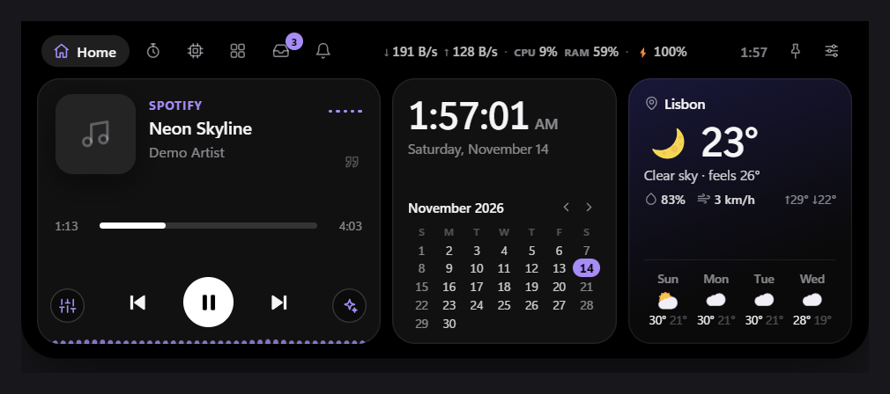
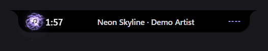
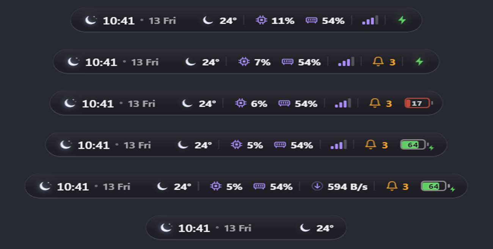
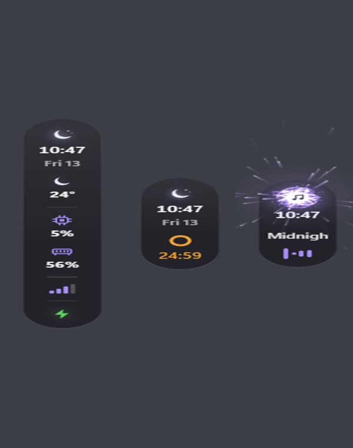
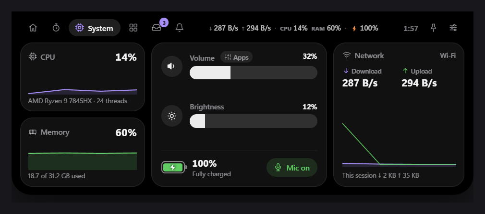
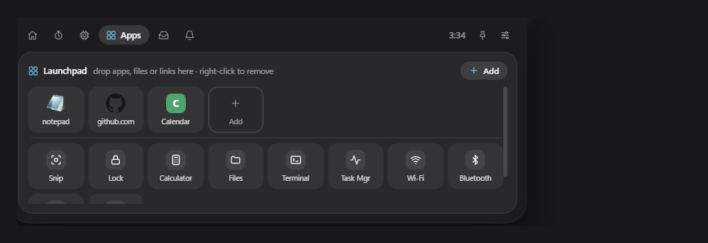
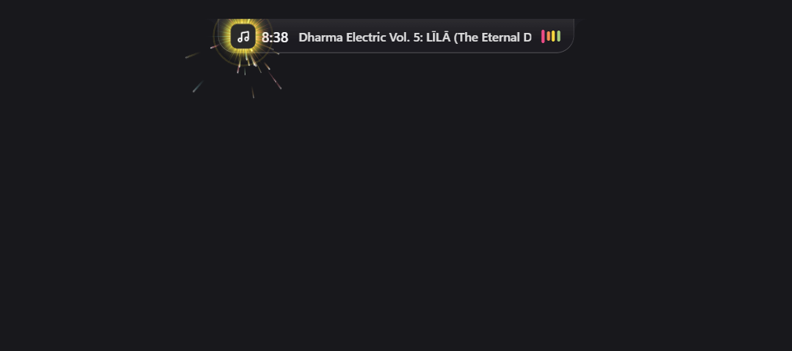
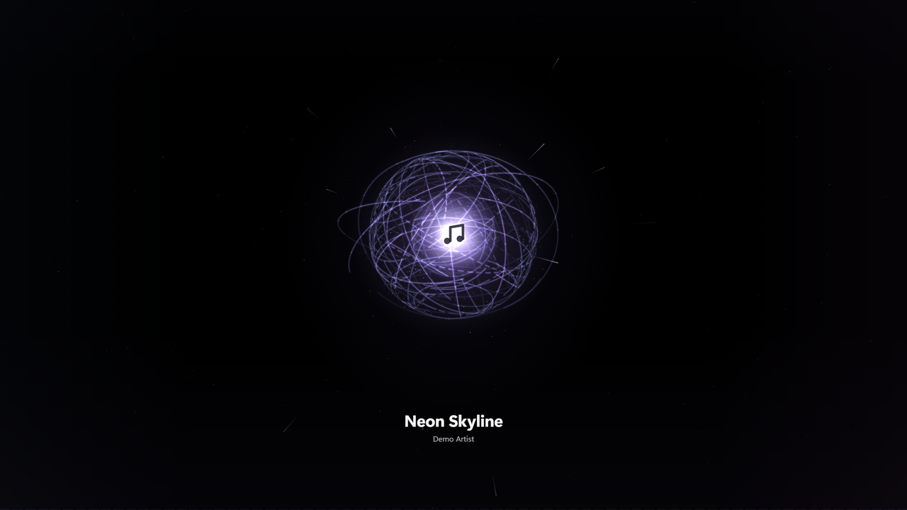
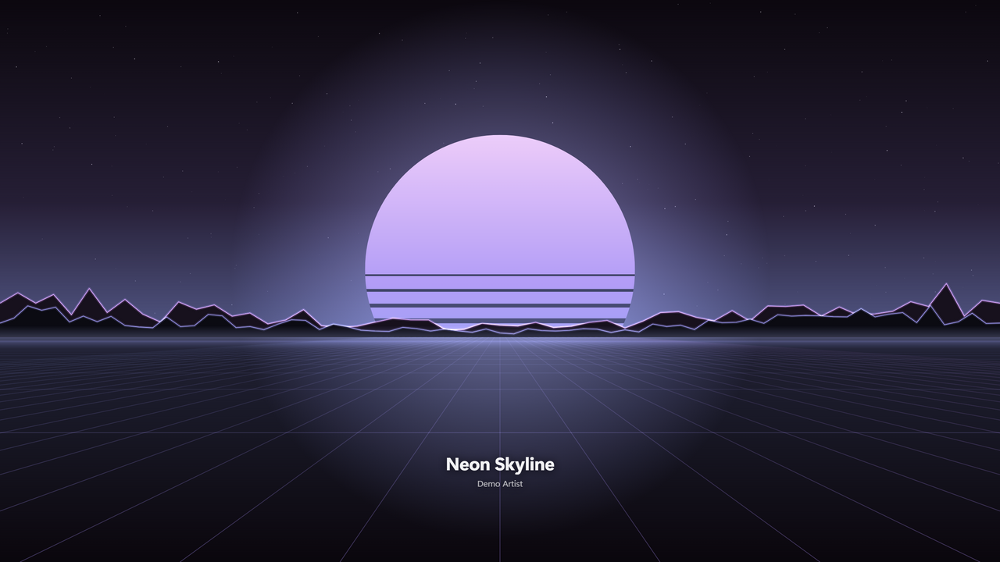
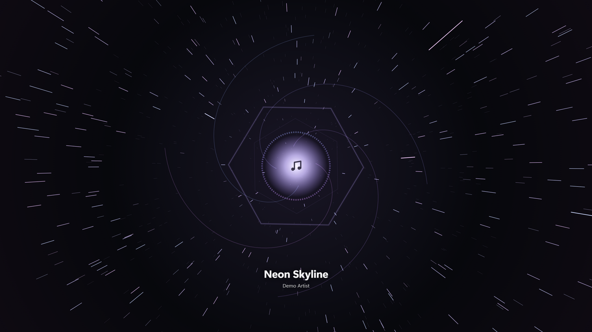

<div align="center">

# NotchMine

**A dynamic notch for Windows.** A small pill at the top of your screen that shows your music, the time, the weather and live system info. Hover it and it opens into a panel of widgets.





Windows 10 / 11 · Electron · Free and open source (MIT)

</div>

---

## Highlights

- 🎵 **Music player for everything:** Spotify, YouTube in any browser, Media Player, VLC, Apple Music… Shows album art, a seekable progress bar, a real audio visualizer and synced lyrics.
- ✨ **Live activities in the pill:** pop-ups for song changes, volume, notifications, screenshots, downloads, USB drives, headphones, battery and timers.
- 🪐 **Music icon effects:** the album art can glow and throw sparks like a sun, or turn into a burning holographic orb, in time with the beat. The orb's spin follows the song's tempo, bass and vocals, and an **Effect sensitivity** slider sets how wildly it reacts.
- 🎉 **Party mode:** a full-screen light show (Club, Synthwave or Warp) driven by whatever is playing, on one screen or all of them.
- 📊 **Desktop equalizer:** see-through, click-through bars that dance along the bottom of your screen while you work.
- 🎬 **Stays out of your movies:** when a video, movie or game goes full screen on the notch's screen, the notch fades to a faint thin line and comes back the moment you hover it. Prefer it gone completely, or always shown? Settings → General → **Full-screen apps** (*Show*, *Fade* or *Hide*).
- 🧭 **Side mode:** when a chosen app (e.g. Chrome) is maximized, the notch moves to the right edge and turns vertical, so it never covers your tabs. While your mouse is away it turns see-through, and it comes straight back when you touch it.
- 🎨 **Make it yours:** Notch or Island shape, four styles, four sizes, any accent colour, visualizer palettes (presets or your own mix), and drag it anywhere on any monitor.

## Screenshots

| Idle pill (time, weather, system, alerts, battery) | Side mode (vertical, on the right edge) |
|---|---|
|  |  |

| System | Apps (launchpad) |
|---|---|
|  |  |

| Appearance settings | |
|---|---|
|  | |

**Party mode**

| Club | Synthwave | Warp |
|---|---|---|
|  |  |  |

---

## Install

### Option 1: download (easiest)
1. Go to the [**Releases**](../../releases) page and download the latest `NotchMine x.y.z.exe` (portable, nothing to install).
2. Run it. The notch appears at the top of your screen and an icon appears in the system tray.
3. NotchMine starts with Windows automatically. To turn that off, use Settings → General → **Launch at login** or the tray menu. If you use the portable `.exe`, keep it in a fixed folder, for example `C:\Apps\NotchMine`, rather than in Downloads.

> **"Windows protected your PC"?** The app isn't code-signed, so SmartScreen warns about it. Click **More info → Run anyway**.

### Option 2: run from source
Requires [Node.js](https://nodejs.org) 18 or newer.

```powershell
git clone https://github.com/subhacasual/NotchMine.git
cd NotchMine
npm install
npm start
```

Build your own `.exe` (portable + installer, written to `dist/`):

```powershell
npm run dist
```

---

## Using it

| Do this | What happens |
|---|---|
| **Hover** the pill | Opens the panel (or **click**, if you set *Open* to *Click*) |
| **Scroll** on the pill | Changes the volume |
| **Swipe sideways** on the pill (touchpad) | Next / previous track |
| **Double-click** the pill | Play / pause |
| **Middle-click** the pill | Mute |
| **Press and drag** the pill, or the open panel's top bar | Move it, including onto another monitor |
| <kbd>Ctrl</kbd> + <kbd>Alt</kbd> + <kbd>N</kbd> | Show / hide the notch |
| <kbd>Ctrl</kbd> + <kbd>Alt</kbd> + <kbd>M</kbd> | Mute / unmute your microphone (meeting mode) |
| <kbd>Ctrl</kbd> + <kbd>Alt</kbd> + <kbd>P</kbd> | Party mode on / off |
| <kbd>Esc</kbd> | Close the panel, or leave party mode |

Right-click the **tray icon** for quick toggles: hide, display, party mode, desktop equalizer, mic, quit.

---

## Features

### The pill
- **No music:** a glowing sun or moon (real day/night), time and date, weather, CPU, RAM, GPU, Wi-Fi bars (download speed only while something is really downloading), unread notifications and a minimal battery (just ⚡ when plugged in and full). Each item can be switched on or off, and there's a **Minimal** mode that shows details only on hover.
- **While music plays:** album art (or the sun/orb effect), the time, the title or the current **lyric line**, and a live equalizer.
- **Focus timer:** a countdown ring while a Pomodoro is running.

### Home
- **Music card:** artwork, app name, seekable progress, previous/play/next, lyrics view (click a line to jump to it), and a spectrum rising from the bottom of the card. Quick buttons start party mode or the desktop equalizer.
- **Clock and month calendar.**
- **Weather** with a 4-day forecast for any city.

### Apps
- **Your own launchpad:** add websites or apps (drag `.exe`/shortcuts/links in, or use *Add*), with real icons.
- **Built-in tiles:** Snip, Lock, Calculator, Files, Terminal, Task Manager, Wi-Fi, Bluetooth, Sound, Settings.

### Shelf
- **File shelf:** drop files on the notch to keep them handy, then drag them out into any app.
- **Recent:** screenshots and finished downloads, with drag-out, **copy text from a screenshot** (offline OCR) and save.
- **Clipboard history.**
- **Phone → PC:** scan a QR code and send photos or files from your phone over your Wi-Fi. Uploads are chunked and resume after interruptions. See [Privacy](#privacy).

### Focus
- **Pomodoro** (25/5 by default, adjustable) plus quick 1/5/10/15-minute timers, with a chime and a daily session count.
- **Quiet mode:** holds notification pop-ups while you focus and tells you how many arrived.
- **Quick notes** that save automatically.

### System
- **CPU, RAM and GPU** graphs (GPU load the way Task Manager measures it, plus graphics memory), plus **network** download/upload speed with session totals.
- **Volume:** master volume plus a **per-app mixer**.
- **Brightness** (laptop screens), **mic mute**, and **battery** status.

### Alerts
- **Windows notifications** (WhatsApp, Discord, Teams, Mail…) mirrored into the notch, with an unread badge.

### Live activities
- **Pop-ups** for song changes, volume, battery/charger, timers, notifications, **camera/mic in use** (green/orange dots), **screenshots** (drag the thumbnail straight into a chat), **downloads**, **USB drives**, **headphones** and **Caps/Num Lock**.

### Party mode 🎉
- **Club:** a big orb or sun throwing sparks and shock rings, club light beams, a pulsing edge glow, floating particles, blurred album art and an equalizer from the floor.
- **Synthwave:** a striped neon sun setting between mountains that dance to the spectrum, over a grid floor that speeds up on the bass.
- **Warp:** hyperspace stars whose speed follows the music, neon rings on the beat, and a wormhole with a round spectrum.
- **Screens and controls:** all screens, the notch's screen or the main screen. Controls fade in when you move the mouse, and the screen is kept awake.

### Desktop equalizer
- **See-through and click-through** bars along the bottom of the screen (above or over the taskbar).
- **Settings:** intensity and height sliders, mirrored or left → right, and which screens.
- Shows only while music plays and hides in full-screen apps.

### Side mode
- **Your own app list** (Chrome by default). When one of them is **maximized** and in front, the notch moves to the middle of the right edge as an upright vertical pill.
- It goes back to its spot as soon as that window is minimized, resized or closed.
- **See-through when idle:** while it rests on the side with the mouse away, it fades out so it doesn't cover the page, and comes back the moment the mouse reaches it. Two sliders (Settings → Side mode) set how see-through the **background** and the **icons & info** get, from solid to completely invisible. Pop-ups and the open panel always show normally.

### Customise
- **Shape:** *Notch* (attached to the top edge) or *Island* (floating, can go anywhere on screen).
- **Layout:** *Tabs* (one section at a time in a wide panel) or *Stacked* (Settings → General): every section at once in a tall column, with music, clock and weather, your apps, the shelf, the focus timer, system stats with volume and brightness sliders, and the latest notifications. Click a section's title to open its full page, and ‹ to go back.
- **Look:** Midnight, Graphite, Glass and Aurora styles, sizes S–XL, and any accent colour (or from the album art).
- **Visualizer colours:** follow the accent, use a preset (Rainbow, Sunset, Ocean, Neon, Fire, Aurora) or mix up to three colours of your own.
- **Music icon effect:** Sun rays, Orb or Off.

---

## Privacy

NotchMine runs on your PC. It has no account, no analytics and no tracking. Only these features go online:

| Feature | What is sent | To |
|---|---|---|
| Weather | Your city's coordinates | [Open-Meteo](https://open-meteo.com) (free, no key) |
| City search | The city name you type | Open-Meteo geocoding |
| Synced lyrics *(can be switched off)* | Song title, artist, album, length | [LRCLIB](https://lrclib.net) (free, no key) |
| Missing album art *(can be switched off; only when the player shares none)* | Song title, artist | [iTunes Search API](https://performance-partners.apple.com/search-api) (free, no key) |
| Website shortcuts | A request for that site's own favicon | The site you added |

Everything else stays on your PC:
- **Audio visualizer:** system audio is analysed live and never recorded or saved.
- **Notifications:** read from Windows' notification centre; nothing leaves your PC.
- **Camera/mic dots:** read from Windows' own privacy records.
- **Wi-Fi bars:** signal strength only. NotchMine never reads your network name and doesn't need location access.
- **Clipboard history:** kept in memory only. Switch it off in Settings.
- **Phone → PC:** only runs while you have it open, and only on your local network. Each session uses a new random link, and it switches off after 10 idle minutes. The transfer is **not encrypted**, so use it on your own Wi-Fi only, never on public networks. The first time, Windows Firewall may ask: allow **Private networks** only.

Settings are stored in `%APPDATA%\NotchMine\settings.json`.

---

## Requirements

- **OS:** Windows 10 (1903 or newer) or Windows 11, 64-bit.
- **Windows PowerShell 5.1:** built into Windows. NotchMine uses it as a small helper for media, volume and device info.
- **Notifications in the notch:** Windows must allow apps to read notifications (Settings → Privacy & security → Notifications).
- **Brightness control:** works on built-in laptop screens only (Windows doesn't expose external monitors).
- **Memory:** roughly 300–400 MB of RAM (it's an Electron app).

---

## Troubleshooting

<details>
<summary><b>The notch doesn't react to my music</b></summary>

The player has to publish to Windows' media controls. Spotify, browsers, Media Player, VLC and most modern players do. Check that the song appears in Windows' own media flyout (volume keys or Quick Settings).
</details>

<details>
<summary><b>The visualizer bars just animate instead of following the music</b></summary>

System-audio capture wasn't available. Make sure *Real audio visualizer* is on (Settings → Appearance) and restart NotchMine.
</details>

<details>
<summary><b>No notifications show up</b></summary>

Allow notification access: Settings → Privacy & security → Notifications. Also check that Do Not Disturb isn't hiding them.
</details>

<details>
<summary><b>The phone can't connect to Phone → PC</b></summary>

- The phone must be on the **same Wi-Fi** as the PC (not mobile data or a guest network).
- Allow NotchMine through Windows Firewall on **Private networks**.
- Keep the phone screen on during big transfers. If it pauses, it resumes by itself.
- Diagnostics are written to `%APPDATA%\NotchMine\phone-drop.log`.
</details>

<details>
<summary><b><code>npm start</code> says "Electron failed to install correctly"</b></summary>

Some npm setups skip Electron's download step. Run:

```powershell
node node_modules/electron/install.js
```

If that still fails, extract `%LOCALAPPDATA%\electron\Cache\*\electron-v*-win32-x64.zip` into `node_modules/electron/dist` and create `node_modules/electron/path.txt` containing `electron.exe`.
</details>

<details>
<summary><b>Electron starts as plain Node and crashes</b></summary>

Your shell has `ELECTRON_RUN_AS_NODE` set (some editors and terminals set it). `npm start` clears it automatically. If you launch `electron.exe` directly, remove that variable first.
</details>

---

## How it works

```
src/
  main.js          Electron main process: windows, tray, hotkeys, settings, side mode, party mode,
                   desktop equalizer, screenshots/downloads watchers, OCR and phone-drop wiring
  preload.js       The safe bridge between the UI and the main process
  lyrics.js        LRCLIB lookup + cache
  artwork.js       Album art lookup (iTunes Search) for players that share none
  phone.js         Phone → PC upload server (chunked, resumable) and the phone web page
  renderer/
    index.html     The notch UI (pill, pop-ups, panel)
    app.js         Core: layout modes, media, clock, weather, timer, system, shelf
    extras.js      Themes, launchpad, notifications, network, visualizer, sun/orb effects
    live.js        Live activities, lyrics, mixer, devices, recent items, phone drop UI
    stack.js       Stacked layout: every section at once in a tall column
    boot.js        Start-up
    party.*        Party mode (one full-screen window per display)
    deskeq.*       Desktop equalizer (click-through window per display)
bridge/
  bridge.ps1       Long-running PowerShell helper (JSON over stdin/stdout): media sessions,
                   Core Audio volume / per-app mixer / mic, brightness, notifications,
                   network, Wi-Fi bars, camera/mic in use, USB drives, lock keys, foreground app, OCR
```

- **The notch window** is transparent, always on top and click-through everywhere except the pill itself.
- **The helper** talks to Windows through WinRT and Win32 APIs, so no extra native modules are needed.
- **Visualizers** analyse system audio through Chromium's desktop loopback capture.

### Self-test screenshots
To check the UI after a change, `NOTCH_SNAP=<folder>` starts the app, runs a scripted tour (every tab, pop-ups, side mode, party mode…), saves PNGs to that folder and quits. `NOTCH_SNAP_STEPS=home,system` limits it to the listed steps. The steps are in `runSnapshots()` in `src/main.js`.

---

## Contributing

Issues and pull requests are welcome. If you report a bug, please include your Windows version, what you were doing, and (for phone drop) the relevant lines from `phone-drop.log`.

## Credits

- Built with [Electron](https://www.electronjs.org).
- Many line icons are adapted from [Feather Icons](https://feathericons.com) (MIT) and [Lucide](https://lucide.dev) (ISC). The weather, sky and party glyphs, the app icon and the tray icon are original.
- Weather data by [Open-Meteo.com](https://open-meteo.com), licensed [CC BY 4.0](https://creativecommons.org/licenses/by/4.0/). The free API is for non-commercial use.
- Synced lyrics from [LRCLIB](https://lrclib.net). Lyrics belong to their songwriters and publishers.
- Missing album art from the [iTunes Search API](https://performance-partners.apple.com/search-api). Artwork belongs to its owners.
- QR codes by [node-qrcode](https://github.com/soldair/node-qrcode) (MIT).

NotchMine is an independent project. It is not affiliated with Apple or Microsoft. "Dynamic Island" is a trademark of Apple Inc. Other app names are trademarks of their owners and are used only to identify those apps. Screenshots use a made-up demo song.

## License

NotchMine is released under the [MIT](LICENSE) license. For third-party licenses and attributions, see [THIRD_PARTY_NOTICES.md](THIRD_PARTY_NOTICES.md).
